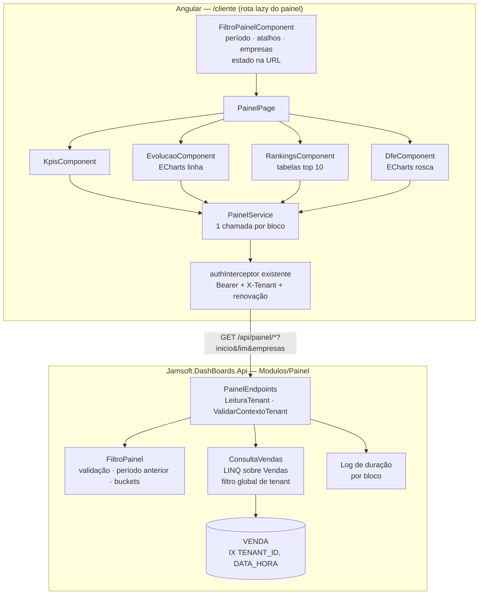

# Painel de Vendas — Indicadores e PWA — Design

**Spec**: `.specs/features/painel-vendas/spec.md`
**Decisões aplicadas**: AD-001 a AD-016; novas AD-017 e AD-018 (`.specs/STATE.md`)
**Depende de**: `plataforma-tenancy-acesso` (verificada) e da tabela `VENDA` de `sincronizacao-vendas` (T4 daquela feature)
**Status**: Draft

---

## Architecture Overview

O painel é **somente leitura**. Um módulo novo na API, `Modulos/Painel`, expõe **um endpoint por bloco**: KPIs, evolução, rankings e NF-e × NFC-e. Todos recebem o mesmo filtro (período e empresas) e são consultas LINQ sobre `VENDA`. Como `Venda` é `IPertenceAoTenant`, o filtro global do EF isola o tenant automaticamente, sem SQL bruto. O agrupamento por dia e por mês usa `AT TIME ZONE` no fuso de São Paulo (AD-018).

No Angular, a página do painel substitui o placeholder de `/cliente`. Cada bloco carrega e falha de forma independente (UI-07/UI-08). Os gráficos usam Apache ECharts, importado de forma modular (tree-shaken) e carregado só na rota do painel (AD-017). A base de PWA (service worker, manifest), o shell, os guards e o interceptor já existem e são reaproveitados; esta feature fecha os avisos de offline e de nova versão.



### Definições (da spec; confirmadas em 2026-10-25)

- **Vendas efetivadas** = situação `Finalizada` ou `Contingência`.
- **Faturamento** = Σ `VALOR` das efetivadas.
- **Nº de vendas** = contagem das efetivadas.
- **Ticket médio** = faturamento ÷ nº de vendas (0 sem vendas).
- **Itens por venda** = Σ `QTD_ITENS` ÷ nº de vendas (0 sem vendas).
- **% canceladas** = nº `Cancelada` ÷ (nº efetivadas + nº `Cancelada`) × 100 (0 sem vendas). `Inutilizada` fica fora de todos os indicadores.
- **Período**: `inicio` e `fim` são datas inclusivas no fuso America/Sao_Paulo, convertidas para o intervalo `[inicio 00:00, fim+1 00:00)` em `DateTimeOffset`. O filtro por faixa usa o índice `(TENANT_ID, DATA_HORA)`.
- **Período anterior**: tem o mesmo número de dias e termina no dia anterior a `inicio`. **Variação %** = (atual − anterior) ÷ anterior × 100, nula quando o anterior é 0.

---

## Code Reuse Analysis

### Existing Components to Leverage

| Component | Location | How to Use |
| --------- | -------- | ---------- |
| Filtro global de tenant + `ITenantAtual` | `Infraestrutura/Dados/PlataformaDbContext.cs`, `Seguranca/TenantAtual.cs` | As consultas do painel são LINQ sobre `Vendas`, então o isolamento vem automático (DASH-07) |
| Policies `LeituraTenant`, `.ValidarContextoTenant()`, `.AuditarContextoSuperAdmin()`, `RotaTenantScoped` | `Seguranca/` | Aplicados ao grupo `/api/painel`. A suíte de isolamento exige um caso por rota nova |
| `Empresas` (filtradas por tenant) | `Modulos/Empresas` | Converte os IDs públicos de empresa do filtro e devolve 404 se algum não for do tenant (DASH-08). Também dá os nomes do ranking de empresas (nome manual tem prioridade) |
| `ProblemasApi.Validacao` | `Infraestrutura/Erros` | 400 `VALIDACAO` com `erros.inicio/fim` (DASH-05) |
| Índice `VENDA (TENANT_ID, DATA_HORA) INCLUDE (...)` | `sincronizacao-vendas` T4 | Cobre KPIs, evolução, DF-e e o agrupamento por código nos rankings |
| `BancoDeTestes`, `ApiFactory`, `Acesso`, `Dados`, suíte de isolamento | `tests/Jamsoft.DashBoards.Api.Testes` | Testes de integração com um conjunto de vendas semeado e valores esperados calculados à mão |
| Shell, `shared/ui` (`estado-carga`), `problema.ts`, `perfilGuard`, `authInterceptor`, `tenant-efetivo.ts`, seletor de tenant | `src/Jamsoft.DashBoards.Web/src/app/` | Layout, estados por bloco, erros, guarda de rota, renovação de sessão (UI-04/UI-05) e SuperAdmin sem tenant |
| `cliente-inicio.page.ts` | `cliente/` | **Substituído** pela `PainelPage` na rota `/cliente` |
| PWA (`@angular/pwa`, `ngsw-config.json`, `provideServiceWorker`) | `src/Jamsoft.DashBoards.Web` | Já instalado; esta feature valida o manifest e a política de cache e adiciona os avisos de offline e de nova versão |
| Padrão "Relatório Painel" do Design System | canvas §3.1, `RelatorioPainel.dc.html` | Card de filtros, blocos de KPI com valor e "% do faturamento", tabelas de ranking |
| Playwright (e2e da feature anterior) | `src/Jamsoft.DashBoards.Web/e2e/` | Mesmo setup (banco descartável, API e Web reais), agora semeando vendas por SQL |

### Integration Points

| System | Integration Method |
| ------ | ------------------ |
| `sincronizacao-vendas` | Lê a tabela `VENDA` e as empresas que a ingestão cria. Não chama nenhum endpoint do Coletor |
| Header do shell | O `status-dados.component` de `sincronizacao-vendas` (T45) convive com o painel. Esta feature não o altera |

---

## Components — API (`Modulos/Painel`)

### FiltroPainel

- **Purpose**: transformar `inicio`, `fim` e `empresas` em um filtro validado.
- **Location**: `Modulos/Painel/FiltroPainel.cs`
- **Interfaces**:
  - `static bool TentarCriar(DateOnly? inicio, DateOnly? fim, Guid[]? empresas, DateOnly hoje, out FiltroPainel filtro, out Dictionary<string,string[]> erros)`
  - Propriedades: `Inicio`, `Fim`, `DesdeUtc`, `AteUtcExclusivo`, `Dias`, `Anterior` (o período anterior equivalente, já como `FiltroPainel`), `Granularidade` (`Dia` se ≤ 62 dias, senão `Mes`), `Buckets()` (todos os dias ou meses do período, para preencher zeros).
- **Regras**:
  - Sem datas, o período é o mês corrente (dia 1 até hoje, no fuso de São Paulo) (DASH-01).
  - `fim < inicio` → erro em `fim`. Período acima de 24 meses (`fim > inicio.AddMonths(24).AddDays(-1)`) → erro (DASH-05).
  - `hoje` vem de `TimeProvider`.
- **Requisitos**: DASH-01, DASH-05, DASH-09, TRD-01, TRD-02, TRD-03

### ConsultaVendas

- **Purpose**: base de consulta comum a todos os blocos.
- **Location**: `Modulos/Painel/ConsultaVendas.cs`
- **Interfaces**:
  - `IQueryable<Venda> Do(FiltroPainel f, int[]? empresaIds)`: `Vendas` (com filtro global) na faixa `[DesdeUtc, AteUtcExclusivo)` e, quando informado, `EMPRESA_ID IN (...)`.
  - `Task<int[]?> ResolverEmpresasAsync(Guid[]? idsPublicos)`: converte via `banco.Empresas`, que já vem filtrado pelo tenant. Se a contagem não bater, lança `ProblemaApiException(404, NAO_ENCONTRADO)` (DASH-08).
- **Requisitos**: DASH-04, DASH-07, DASH-08

### PainelEndpoints

Grupo `/api/painel`, com `.RequireAuthorization(LeituraTenant).ValidarContextoTenant().AuditarContextoSuperAdmin()`. Query string comum: `inicio=yyyy-MM-dd&fim=yyyy-MM-dd&empresas=<guid>&empresas=<guid>`.

| Rota | Resposta | Requisitos |
| ---- | -------- | ---------- |
| `GET /api/painel/kpis` | `{ periodo:{inicio,fim}, anterior:{inicio,fim}, semVendas, kpis:{ faturamento, vendas, ticketMedio, itensPorVenda, percentualCanceladas } }`. Cada KPI vem como `{ atual, anterior, variacao }` | DASH-01..09 |
| `GET /api/painel/evolucao` | `{ granularidade:"dia"\|"mes", pontos:[{ rotulo, data, atual, anterior }] }`, com os pontos alinhados por posição (1º dia do período ↔ 1º dia do anterior) e zeros preenchidos | TRD-01..03 |
| `GET /api/painel/rankings` | `{ totalFaturamento, vendedores:[item], clientes:[item], empresas:[item] }`. Cada `item` é `{ nome, faturamento, vendas, participacao }`, com até 10 por lista | RNK-01..04 |
| `GET /api/painel/dfe` | `{ tipos:[{ tipo:"NF-e"\|"NFC-e", faturamento, vendas, participacao }] }`, sempre com os 2 tipos | DFE-01, DFE-02 |

**Detalhes de cálculo**:
- **KPIs**: uma consulta agregada por período (atual e anterior), com `GroupBy(_ => 1)` e somas condicionais (`Sum(v => efetivada ? v.Valor : 0)`, contagens por situação). As fórmulas ficam em C#. Arredondamento de 2 casas na resposta (valores monetários e percentuais).
- **Evolução**: `GroupBy(EF.Functions.AtTimeZone(v.DataHora, "E. South America Standard Time").Date)` por dia, ou ano e mês na granularidade mensal, somando só as efetivadas. Os zeros são preenchidos em C# com `FiltroPainel.Buckets()`. O período anterior usa os mesmos buckets, deslocados.
- **Rankings**: há duas etapas, para não ler colunas fora do índice.
  1. Agrupa por `VendedorCodigo` (e por `CodCliente`, `EmpresaId`) com soma e contagem, ordena por faturamento decrescente e pega o top 10. O código nulo vira o grupo "Não informado" (RNK-03).
  2. Busca os nomes só desses 10 códigos (último nome recebido; para empresas, `EMPRESA.NOME`).
  3. Desempata por nome em ordem alfabética, com `StringComparer` da cultura pt-BR (RNK-04). Participação = faturamento ÷ total do período × 100.
- **DF-e**: `GroupBy(TipoDfe)` sobre as efetivadas, completando o tipo ausente com zero.

**Observabilidade**: um endpoint filter loga, para cada bloco, o tempo de resposta (`Painel {Bloco} {DuracaoMs} ms`, tenant e tamanho do período, sem dados de venda). Isso alimenta a medição da meta de 2 s.

---

## Components — Frontend

Tudo fica em `src/Jamsoft.DashBoards.Web/src/app/cliente/painel/`, carregado como rota lazy em `/cliente`, que passa a abrir o painel. O SuperAdmin sem tenant selecionado vê o seletor (comportamento atual do guard e do `tenant-efetivo`).

- **`painel.service.ts`**: `kpis(filtro)`, `evolucao(filtro)`, `rankings(filtro)` e `dfe(filtro)` → `Observable`. Monta a query string a partir do filtro. As chamadas passam pelo `authInterceptor` real (UI-05).
- **`filtro-painel.component.ts`**: data inicial e final (inputs `date`), atalhos (Este mês, Últimos 7 dias, Últimos 30 dias, Mês anterior), multisseleção de empresas (só aparece quando o tenant tem mais de uma) e botão "Atualizar". Valida antes de consultar: fim < início ou período acima de 24 meses mostra a mensagem e não chama a API (DASH-05). O filtro vive na **URL** (`?inicio&fim&empresas`), o que permite recarregar e compartilhar o link.
- **`painel.page.ts`**: layout em grid responsivo (1 coluna até 768 px; KPIs em 2 colunas no celular e 5 no desktop; evolução em largura total; rankings e DF-e lado a lado a partir de 1024 px). Orquestra os 4 blocos com um `resource`/signal por bloco. Mostra a mensagem "Nenhuma venda no período" quando `kpis.semVendas`, ou "Nenhuma venda sincronizada ainda" quando o tenant nunca sincronizou (edge case, via resumo de sincronização).
- **`kpis.component.ts`**: 5 blocos no padrão "Relatório Painel". Cada um mostra o valor (BRL, número ou %) e a variação contra o período anterior, com seta e cor de estado (sucesso/perigo do DS, com ícone e texto, nunca só cor). Variação nula → "—".
- **`evolucao.component.ts`**: ECharts de linha. Período atual em `--primary`; anterior tracejado em `--text-muted`. Tooltip com a data, o atual e o anterior em BRL (TRD-04). Funciona com toque. O eixo usa o rótulo do bucket (dd/MM ou MMM/yy).
- **`rankings.component.ts`**: 3 tabelas (Vendedores, Clientes e Empresas) com nome, faturamento, nº de vendas e participação, mais uma barra inline em CSS. O ranking de Empresas fica oculto quando o tenant tem uma única empresa (RNK-05). Em telas estreitas, as tabelas rolam dentro do próprio card, nunca a página.
- **`dfe.component.ts`**: ECharts de rosca com NF-e e NFC-e e legenda com valor, quantidade e %.
- **`graficos/echarts.ts`**: importação modular (`echarts/core` + `LineChart`, `PieChart`, `GridComponent`, `TooltipComponent`, `LegendComponent`, `CanvasRenderer`) e `tema-graficos.ts`, que lê os tokens do DS (`--primary`, `--text-muted`, fontes Inter e JetBrains Mono) para cores e fontes. Tudo carregado só na rota lazy do painel (AD-017).
- **Formatação**: `registerLocaleData(pt)`, `LOCALE_ID = 'pt-BR'`, `DEFAULT_CURRENCY_CODE = 'BRL'` e `DATE_PIPE_DEFAULT_OPTIONS` com `timezone` de São Paulo.

### Perfil e navegação (UI-01..04)

- O menu do shell por perfil ganha os itens novos:
  - **Consulta**: Painel e Meu perfil.
  - **Admin**: Painel, Usuários, Empresas, Sincronização e Meu perfil.
  - **SuperAdmin**: Tenants, Coletores, Auditoria e seletor de tenant. Com um tenant selecionado, também Painel, Usuários, Empresas e Sincronização.
- **`conta/perfil.page.ts`** ("Meu perfil"): mostra nome, e-mail, perfil e tenant de `/api/auth/eu`, com link para "Trocar senha" (UI-01).
- O guard existente cobre as rotas novas. Os testes da matriz de perfis ganham as rotas `/cliente` (painel), `/cliente/sincronizacao`, `/admin/coletores` e `/conta/perfil` (UI-04).

### PWA

- **PWA-01**: o `manifest.webmanifest` traz nome "JAMSOFT Dashboards", `short_name`, ícones 192 e 512 (gerados a partir da logo, sobre fundo vermelho do DS), `display: standalone`, `theme_color` `#F2323F` e `background_color` `#FBFAF7`.
- **PWA-02**: o `ngsw-config.json` tem **apenas** `assetGroups` (app shell, assets e fontes) e **nenhum** `dataGroups`. Um teste lê o arquivo e falha se surgir um `dataGroup` ou se alguma URL `/api` aparecer.
- **PWA-03**: `conexao.service.ts` usa `navigator.onLine` e os eventos `online`/`offline`. Sem conexão, o shell mostra a faixa "Sem conexão" e os blocos do painel exibem "Sem conexão" em vez de tentar consultar.
- **PWA-04**: `atualizacao.service.ts` escuta `SwUpdate.versionUpdates` (`VERSION_READY`) e mostra a faixa "Nova versão disponível" com o botão "Recarregar" (`activateUpdate` + `location.reload`).
- **PWA-05/06**: layout fluido sem largura fixa e tabelas com rolagem interna. O e2e roda em 360 × 740 e 1920 × 1080 e verifica que `document.documentElement.scrollWidth <= clientWidth`. O Playwright ganha os projetos `firefox` e `webkit`, além do `chromium`, para um smoke do painel.
- **PWA-07**: o logout já limpa os tokens e o tenant selecionado. Um teste confirma que, depois do logout, `sessionStorage` e `localStorage` não têm chaves da aplicação e que nenhuma resposta da API ficou em cache (`caches.keys()` não contém dados de `/api`).

---

## Data Models

Nenhuma tabela nova. O painel lê `VENDA` (de `sincronizacao-vendas`) e `EMPRESA`. Os DTOs de resposta ficam em `Modulos/Painel/RespostasPainel.cs`:

```csharp
public sealed record Indicador(decimal Atual, decimal Anterior, decimal? Variacao);
public sealed record KpisResposta(Periodo Periodo, Periodo Anterior, bool SemVendas,
    Indicador Faturamento, Indicador Vendas, Indicador TicketMedio, Indicador ItensPorVenda,
    Indicador PercentualCanceladas);
public sealed record PontoEvolucao(string Rotulo, DateOnly Data, decimal Atual, decimal Anterior);
public sealed record EvolucaoResposta(string Granularidade, IReadOnlyList<PontoEvolucao> Pontos);
public sealed record ItemRanking(string Nome, decimal Faturamento, int Vendas, decimal Participacao);
public sealed record RankingsResposta(decimal TotalFaturamento, IReadOnlyList<ItemRanking> Vendedores,
    IReadOnlyList<ItemRanking> Clientes, IReadOnlyList<ItemRanking> Empresas);
public sealed record ItemDfe(string Tipo, decimal Faturamento, int Vendas, decimal Participacao);
public sealed record DfeResposta(IReadOnlyList<ItemDfe> Tipos);
public sealed record Periodo(DateOnly Inicio, DateOnly Fim);
```

---

## Error Handling Strategy

| Error Scenario | Handling | User Impact |
| -------------- | -------- | ----------- |
| Fim antes do início ou período acima de 24 meses | Frontend valida e não consulta; a API devolve 400 `VALIDACAO` com `erros.fim` | Mensagem no filtro |
| Empresa de outro tenant (ou inexistente) no filtro | 404 `NAO_ENCONTRADO` | Aviso no filtro; a seleção é limpa |
| Sem vendas no período | 200 com zeros e `semVendas = true` | KPIs zerados + "Nenhuma venda no período" |
| Tenant nunca sincronizado | 200 com zeros; resumo de sincronização com `null` | "Nenhuma venda sincronizada ainda" |
| Falha de um bloco (500 ou rede) | O bloco mostra o erro e "Tentar novamente"; os demais seguem | UI-08 |
| Sem conexão | Faixa "Sem conexão"; os blocos não consultam | PWA-03 |
| 401 | `authInterceptor` renova uma vez; se falhar, leva ao login | UI-05 |
| 403 `ACESSO_DESATIVADO` | `authInterceptor` vai ao login com o aviso | Comportamento da feature anterior |
| SuperAdmin sem tenant | Guard/`tenant-efetivo` mostram o seletor | Sem consulta |

---

## Risks & Concerns

| Concern | Location (file:line) | Impact | Mitigation |
| ------- | -------------------- | ------ | ---------- |
| `EF.Functions.AtTimeZone(...).Date` pode não traduzir para SQL em todo `GroupBy` | `Modulos/Painel/PainelEndpoints.cs` (a criar) | Avaliação no cliente (lenta) ou exceção | O teste de integração usa `ConfigureWarnings(Throw on ClientEvaluation)`. Se não traduzir, o fallback é `Database.SqlQuery<T>` com SQL fixo, **com `TENANT_ID = @TenantId` explícito** e um teste de isolamento dedicado (registrar como SPEC_DEVIATION) |
| Meta p95 ≤ 2 s com 1 milhão de vendas não é verificável no SQL Server local, que está com pouca memória | Ambiente | Meta sem evidência | Tarefa de medição separada (T22) com um script de carga e um relatório. Fica fora do gate e é rodada num ambiente com memória adequada. Se não atingir a meta, Design decide sobre agregados pré-calculados (premissa da spec) |
| Rankings agrupando por código: o mesmo vendedor com nomes diferentes ao longo do tempo | `ConsultaVendas` | Nome exibido inconsistente | Usa o nome da venda mais recente do grupo; documentado |
| ECharts é pesado (~300 KB gz mesmo modular) | Bundle Web | PWA mais lenta no celular | Importação modular só dos gráficos usados, chunk lazy na rota do painel e budget de bundle verificado no build (`ng build` com budget do chunk inicial inalterado) |
| Cores só por matiz nas variações (verde/vermelho) | `kpis.component.ts` | Acessibilidade | Seta e texto ("+12,3%"), e os pares de cor passam no contraste 4.5:1 do DS |
| `DATA_HORA` nula não existe, mas uma venda pode chegar com hora 00:00 (fallback do Coletor) | Evolução diária | Distorção mínima na hora | Não afeta o agrupamento por dia; sem ação |

---

## Tech Decisions (only non-obvious ones)

| Decision | Choice | Rationale |
| -------- | ------ | --------- |
| Biblioteca de gráficos | Apache ECharts, import modular via `echarts/core`, só na rota lazy do painel (AD-017) | Escolha do usuário; tooltips ricos e boa interação por toque; o peso é mitigado com tree-shaking e lazy load |
| Formato da API | Um endpoint por bloco (`/api/painel/kpis`, `/evolucao`, `/rankings`, `/dfe`) | Escolha do usuário; carga e falha independentes (UI-07/UI-08) |
| Consulta | LINQ sobre `Vendas`, com o filtro global de tenant e sem SQL bruto | Isolamento garantido pelo mesmo mecanismo verificado na feature anterior |
| Fuso no agrupamento | `AT TIME ZONE 'E. South America Standard Time'` na API e `timezone` de São Paulo nos pipes do Angular (AD-018) | Dia e mês corretos independentemente do fuso do servidor ou do navegador |
| Vendas efetivadas | `Finalizada` + `Contingência` | Decisão do usuário (2026-10-25) |
| Estado do filtro | Query string da URL | Recarregar e compartilhar o link mantém o filtro; o botão voltar funciona |
| Rankings em duas etapas | Agrupa por código dentro do índice e busca nomes só do top 10 | Evita ler colunas fora do índice em todas as vendas |
