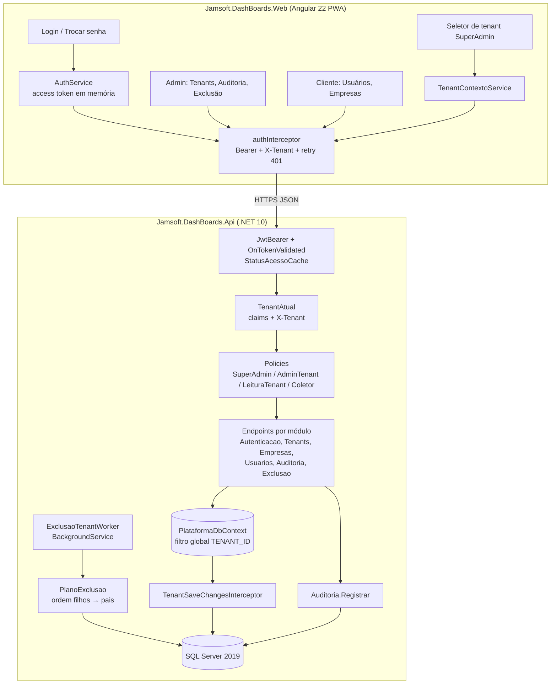

# Plataforma — Tenancy, Usuários e Acesso — Design

**Spec**: `.specs/features/plataforma-tenancy-acesso/spec.md`
**Decisões aplicadas**: AD-001 a AD-008; novas AD-009 a AD-012 (`.specs/STATE.md`)
**Status**: Approved

---

## Architecture Overview

Monolito modular (AD-009): um projeto ASP.NET Core .NET 10 com Minimal APIs, organizado em pastas por funcionalidade, um único `DbContext` EF Core com filtro global por tenant e um interceptor que impede escrita fora do tenant. Usuários ficam em tabela própria (AD-010); o ASP.NET Core Identity entra só com o `PasswordHasher<T>`. Erros saem como ProblemDetails (AD-011). Banco em UPPER_SNAKE_CASE (AD-012).



### Fluxo de requisição tenant-scoped

```mermaid
sequenceDiagram
    participant W as Angular
    participant J as JwtBearer
    participant T as TenantAtual
    participant E as Endpoint
    participant D as DbContext
    W->>J: GET /api/usuarios (Bearer, X-Tenant opcional)
    J->>J: valida assinatura/expiração
    J->>J: OnTokenValidated: usuário e tenant ativos? (cache 60 s)
    J-->>W: 403 ACESSO_DESATIVADO se inativo
    J->>T: claims (perfil, tenant, trocar_senha)
    T->>T: SuperAdmin → tenant = X-Tenant<br/>Admin/Consulta → tenant do token;<br/>X-Tenant diferente → 403 + auditoria
    T->>E: policy aprovada
    E->>D: consulta (filtro TENANT_ID = TenantAtual.Id)
    D-->>E: só linhas do tenant
```

---

## Code Reuse Analysis

O repositório ainda não tem código. A referência interna é o projeto **Jamsoft.Sge.Mcp** (`Jamsoft.Sge.Mcp.zip`), de onde vêm convenções e trechos.

### Existing Components to Leverage

| Component | Location | How to Use |
| --------- | -------- | ---------- |
| Convenções de código | `Jamsoft.Sge.Mcp/src/**` | Nomes em português (`Seguranca/`, `Dados/`, `Configuracao/`), primary constructors, `sealed`, options com `ValidateOnStart`, comentários XML curtos em pt-BR |
| `ApiKey` (geração aleatória com `RandomNumberGenerator.GetString`, hash SHA-256) | `Seguranca/ApiKey.cs` | Mesmo padrão para gerar e fazer hash de refresh tokens (aqui) e `client_secret` do Coletor (feature `sincronizacao-vendas`) |
| Comparação em tempo constante | `Seguranca/RepositorioChaves.cs` (`CryptographicOperations.FixedTimeEquals`) | Comparar hashes de refresh token |
| Cache de status com `IMemoryCache` | `Seguranca/RepositorioChaves.cs` | `StatusAcessoCache`: usuário/tenant ativo, TTL 60 s |
| Comandos CLI no mesmo executável | `Cli/ComandosCli.cs` + `Program.cs` (`TentarExecutar`) | `dotnet run -- criar-superadmin` e `dotnet run -- migrar` sem subir o servidor |
| Options tipadas | `Configuracao/McpOptions.cs` | `JwtOptions`, `AcessoOptions` (tentativas, bloqueio, TTLs) |
| Challenge 401 com JSON | `Seguranca/ApiKeyAuthenticationHandler.cs` | Reescrito como ProblemDetails (AD-011) |

### Integration Points

| System | Integration Method |
| ------ | ------------------ |
| Feature `sincronizacao-vendas` | Usa `Policies.Coletor`, `TenantAtual`, `IEmpresas.ObterOuCriarAsync` (EMP-04) e registra suas tabelas no `PlanoExclusao` |
| Feature `painel-vendas` | Usa `Policies.LeituraTenant`, `TenantAtual`, guards/interceptor do Angular e o seletor de tenant |
| Design System (artifact do §3.1) | Tokens de cor/tipografia/espaçamento traduzidos para `styles/_tokens.scss` do Angular na primeira tarefa de frontend |

---

## Estrutura da solução

```
Jamsoft.DashBoards.slnx
src/
  Jamsoft.DashBoards.Api/
    Program.cs
    Cli/ComandosCli.cs                  criar-superadmin, migrar
    Configuracao/                       JwtOptions, AcessoOptions
    Infraestrutura/
      Dados/PlataformaDbContext.cs
      Dados/Convencoes/NomesUpperSnake.cs
      Dados/TenantSaveChangesInterceptor.cs
      Dados/Migrations/
      Erros/ProblemasApi.cs             fábrica de ProblemDetails + códigos
      Erros/TratadorExcecoes.cs         IExceptionHandler
    Seguranca/
      TenantAtual.cs                    ITenantAtual (scoped)
      Policies.cs                       nomes + registro das policies
      StatusAcessoCache.cs
      TokenService.cs                   emite JWT
      RefreshTokens.cs
      ValidacaoContextoTenantFilter.cs  IEndpointFilter (ISO-04/CTX-03)
    Modulos/
      Autenticacao/  (Endpoints, LoginHandler, TrocarSenha, Bloqueio)
      Tenants/       (Tenant.cs, TenantsEndpoints.cs, Cnpj.cs)
      Empresas/      (Empresa.cs, EmpresasEndpoints.cs, IEmpresas)
      Usuarios/      (Usuario.cs, UsuariosEndpoints.cs, RegrasUltimoAdmin.cs)
      Auditoria/     (RegistroAuditoria.cs, IAuditoria, AuditoriaEndpoints.cs)
      Exclusao/      (ExclusaoTenant.cs, PlanoExclusao.cs, ExclusaoTenantWorker.cs, Endpoints)
  Jamsoft.DashBoards.Web/               Angular 22
    src/app/core/auth/                  auth.service, auth.interceptor, perfil.guard, tenant-contexto.service
    src/app/admin/                      tenants/, auditoria/, exclusao/
    src/app/cliente/                    usuarios/, empresas/
    src/app/conta/                      login/, trocar-senha/
tests/
  Jamsoft.DashBoards.Api.Testes/        xUnit + WebApplicationFactory + Testcontainers.MsSql
  Jamsoft.DashBoards.Web (specs Vitest dentro do projeto Angular)
```

---

## Components

### PlataformaDbContext + convenções

- **Purpose**: Mapear as entidades da plataforma com nomes UPPER_SNAKE e isolamento automático por tenant.
- **Location**: `src/Jamsoft.DashBoards.Api/Infraestrutura/Dados/`
- **Interfaces**:
  - `interface IPertenceAoTenant { int TenantId { get; set; } }` — marca entidades com `TENANT_ID`.
  - `PlataformaDbContext(DbContextOptions, ITenantAtual)` — em `OnModelCreating`, para todo tipo `IPertenceAoTenant`, aplica o filtro nomeado `"Tenant"`: `e => e.TenantId == tenantAtual.IdOuSemAcesso`. Sem tenant resolvido, `IdOuSemAcesso = -1` (não retorna nada).
  - `NomesUpperSnake.Aplicar(ModelBuilder)` — `TenantId` → `TENANT_ID`, tabela `Usuario` → `USUARIO`.
  - `TenantSaveChangesInterceptor` — em `Added`, preenche `TenantId` com o tenant atual quando zero; em qualquer estado, lança `AcessoCruzadoException` (→ 403 + auditoria) se `TenantId` ≠ tenant atual. Ignorado só em operações marcadas com `using (contexto.OperacaoGlobal())`, permitidas a SuperAdmin e ao worker de exclusão.
- **Dependencies**: `Microsoft.EntityFrameworkCore.SqlServer` 10.x, `ITenantAtual`.
- **Reuses**: —
- **Requisitos**: ISO-01, ISO-02, ISO-05, TEN-07

### TenantAtual

- **Purpose**: Resolver, uma vez por requisição, quem chama e em qual tenant.
- **Location**: `Seguranca/TenantAtual.cs`
- **Interfaces**:
  - `Perfil Perfil` (`SuperAdmin | Admin | Consulta | Coletor`)
  - `int? Id` / `Guid? IdPublico` — tenant efetivo
  - `int IdOuSemAcesso`
  - `int UsuarioId`, `bool TrocaSenhaPendente`
  - `IReadOnlySet<int> TenantsAutorizadosColetor` (usado pela feature de sincronização)
- **Regras**: Admin/Consulta → claim `tenant`. Cabeçalho `X-Tenant` igual é ignorado; diferente → 403 `TENANT_DIVERGENTE` + auditoria. SuperAdmin → `X-Tenant`, se enviado (CTX-01); sem ele, `Id = null` e as rotas tenant-scoped respondem 400 `TENANT_NAO_SELECIONADO`. O `ID_PUBLICO` é convertido para `ID INT` com cache em memória (5 min).
- **Requisitos**: ISO-01, ISO-04, CTX-01, CTX-03

### Autenticação (módulo `Autenticacao`)

- **Purpose**: Login, renovação, logout, troca de senha e bloqueio.
- **Location**: `Modulos/Autenticacao/`, `Seguranca/TokenService.cs`, `Seguranca/RefreshTokens.cs`
- **Interfaces (HTTP)**:
  - `POST /api/auth/login` `{ email, senha }` → `200 { accessToken, expiraEm, perfil, tenant: { idPublico, nome } | null, trocarSenha }` + cookie `rt` (AUTH-01)
  - `POST /api/auth/refresh` (cookie `rt` + cabeçalho `X-Requested-With: jamsoft`) → novo par (AUTH-04/05)
  - `POST /api/auth/logout` → revoga a família do refresh, apaga o cookie (AUTH-06)
  - `POST /api/auth/trocar-senha` `{ senhaAtual, novaSenha }` (USR-08)
  - `GET /api/auth/eu` → dados do usuário logado
- **Regras**:
  - JWT HS256, 15 min. Claims: `sub` (ID_PUBLICO do usuário), `perfil`, `tenant` (ID_PUBLICO), `trocar_senha`, `jti`.
  - Refresh token: 48 caracteres aleatórios. No banco fica só o SHA-256, com `FAMILIA` (GUID por login). Reuso de token já usado → revoga todos os refresh tokens do usuário (AUTH-05).
  - O refresh vai em cookie `HttpOnly; Secure; SameSite=Strict; Path=/api/auth` (AD-010). O access token fica só em memória no Angular.
  - Bloqueio: `FALHAS_LOGIN` incrementa em transação; na 5ª falha, `BLOQUEADO_ATE = agora + 15 min` → 423 (AUTH-03). Sucesso zera.
  - E-mail inexistente também roda `PasswordHasher.VerifyHashedPassword` contra um hash fictício, para igualar o tempo de resposta (AUTH-02).
  - Rate limiter nativo (`AddRateLimiter`) no `/api/auth/login`: 20 req/min por IP.
  - `OnTokenValidated` consulta o `StatusAcessoCache` (60 s): usuário ou tenant inativo → falha de autenticação respondida como 403 `ACESSO_DESATIVADO` (via `OnChallenge`), não 401, para o frontend não tentar renovar; a renovação (`/api/auth/refresh`) também responde 403 `ACESSO_DESATIVADO` (AUTH-07, USR-06, edge "tenant inativado durante sessão"; decisão do usuário em 2026-10-25).
- **Dependencies**: `Microsoft.AspNetCore.Authentication.JwtBearer`, `Microsoft.Extensions.Identity.Core` (`PasswordHasher<Usuario>`).
- **Reuses**: padrão de geração/hash de `ApiKey.cs`, `FixedTimeEquals`, cache de `RepositorioChaves`.
- **Requisitos**: AUTH-01..AUTH-09, USR-08

### Policies

- **Location**: `Seguranca/Policies.cs`

| Policy | Regra |
| ------ | ----- |
| *Fallback* (todas as rotas) | Autenticado **e** `trocar_senha` ≠ true (exceto rotas marcadas `.AllowTrocaSenhaPendente()`) |
| `SuperAdmin` | perfil = SuperAdmin |
| `AdminTenant` | (perfil = Admin) ou (SuperAdmin com tenant selecionado) |
| `LeituraTenant` | perfil ∈ {Consulta, Admin} ou (SuperAdmin com tenant selecionado) |
| `Coletor` | perfil = Coletor (detalhada na feature de sincronização) |

Token de perfil `Coletor` não atende a nenhuma outra policy (COL-09). Requisitos: AUTH-08, TEN-08, USR-10, DEL-01.

### Tenants (módulo `Tenants`)

- **Interfaces (HTTP, policy `SuperAdmin`)**:
  - `GET /api/admin/tenants?busca=&situacao=&pagina=1&tamanho=20` (máx. 100) (TEN-04)
  - `POST /api/admin/tenants` `{ nome, cnpj, adminInicial?: { nome, email, senhaInicial } }` → 201 (TEN-01/03)
  - `GET /api/admin/tenants/{idPublico}`, `PUT /api/admin/tenants/{idPublico}` (com `versao` para concorrência)
  - `POST /api/admin/tenants/{idPublico}/inativar` | `/reativar` (TEN-05/06)
- **Regras**: `Cnpj.TentarNormalizar` valida os dígitos verificadores e guarda 14 dígitos; índice único → 409 `CNPJ_DUPLICADO` (TEN-02). A criação com Admin inicial roda numa única transação. Inativar/reativar invalida o `StatusAcessoCache` do tenant.
- **Requisitos**: TEN-01..TEN-08

### Empresas (módulo `Empresas`)

- **Interfaces**:
  - HTTP (`AdminTenant` para escrita, `LeituraTenant` para leitura): `GET /api/empresas`, `POST /api/empresas` `{ codEmpresa, nome }`, `PUT /api/empresas/{idPublico}` `{ nome }`
  - Serviço: `IEmpresas.ObterOuCriarAsync(int tenantId, int codEmpresa, string nomeRecebido, CancellationToken)` → `Empresa`. Cria com `NOME_MANUAL = 0`. Se a empresa já existe e `NOME_MANUAL = 0`, atualiza o nome; se `NOME_MANUAL = 1`, mantém (EMP-04/05).
- **Regras**: índice único (`TENANT_ID`, `COD_EMPRESA`) → 409 (EMP-03). Renomear pela API marca `NOME_MANUAL = 1`.
- **Requisitos**: EMP-01..EMP-06

### Usuários (módulo `Usuarios`)

- **Interfaces (HTTP, `AdminTenant`)**: `GET /api/usuarios`, `POST /api/usuarios`, `PUT /api/usuarios/{idPublico}` `{ nome, perfil, ativo, versao }`, `POST /api/usuarios/{idPublico}/redefinir-senha` `{ senhaTemporaria }`
- **Regras**:
  - Perfis aceitos: `Admin` ou `Consulta`; qualquer outro → 403 `PERFIL_NAO_PERMITIDO` (USR-02).
  - E-mail duplicado → 409 `EMAIL_EM_USO`, sem dizer o tenant (USR-03).
  - `RegrasUltimoAdmin.GarantirAsync`: dentro da transação, `SELECT COUNT(*) ... WITH (UPDLOCK, HOLDLOCK) WHERE TENANT_ID=@t AND PERFIL='Admin' AND ATIVO=1 AND ID<>@alvo`; resultado zero → 422 `ULTIMO_ADMIN` (USR-05). O lock evita que dois Admins se rebaixem ao mesmo tempo.
  - Inativar ou redefinir senha → revoga refresh tokens e invalida o `StatusAcessoCache` (USR-06/07).
  - SuperAdmin usa as mesmas rotas com `X-Tenant` (USR-09).
- **Requisitos**: USR-01..USR-10

### Auditoria (módulo `Auditoria`)

- **Interfaces**:
  - `IAuditoria.Registrar(OperacaoAuditada op, Guid? recurso, int? tenantId, string? tenantNome, string resultado, object? detalhes = null)` — adiciona o registro ao `DbContext` atual (vai na mesma transação da operação). Para eventos sem transação de negócio (login, acesso negado), `RegistrarAgoraAsync` grava na hora.
  - `GET /api/admin/auditoria?de=&ate=&tenant=&usuario=&operacao=&pagina=` (`SuperAdmin`) (AUD-03)
- **Regras**: tabela `AUDITORIA` sem FK para `TENANT`; guarda `TENANT_ID_PUBLICO` e `TENANT_NOME` como texto (sobrevive à exclusão). Nenhum endpoint de alteração (AUD-04). O script de permissões nega `UPDATE`/`DELETE` em `AUDITORIA` ao login da aplicação. Acesso de SuperAdmin a contexto de tenant é registrado no máximo 1 vez por (SuperAdmin, tenant, rota) a cada 10 min, para não inundar a tabela (CTX-02).
- **Requisitos**: AUD-01..AUD-04, CTX-02, ISO-04, DEL-08

### Exclusão de tenant (módulo `Exclusao`)

- **Interfaces**:
  - `POST /api/admin/tenants/{idPublico}/exclusao` `{ confirmacaoNome }` → 202 `{ jobId }` (DEL-02/03/09)
  - `GET /api/admin/exclusoes/{jobId}` → situação, etapa, linhas por tabela, erro
  - `POST /api/admin/exclusoes/{jobId}/retomar` → só se `Falhou` (DEL-06)
  - `PlanoExclusao`: lista ordenada de tabelas (filhos → pais), montada a partir do modelo EF (`IPertenceAoTenant`) + ordem topológica das FKs. A tabela `TENANT` vem por último.
  - `ExclusaoTenantWorker : BackgroundService`: a cada 10 s, reivindica um job com `UPDATE TOP(1) ... WITH (UPDLOCK, READPAST) SET SITUACAO='EmExecucao' OUTPUT ... WHERE SITUACAO IN ('Pendente')`.
- **Regras**:
  - Confirmação compara `confirmacaoNome` com o nome do tenant (ordinal, sem trim) → 422 `CONFIRMACAO_INVALIDA`.
  - Job único ativo por tenant: índice único filtrado `WHERE SITUACAO IN ('Pendente','EmExecucao')` → 409 (DEL-09).
  - Por tabela: `DELETE TOP (5000) FROM [{tabela}] WHERE TENANT_ID = @t` em loop até afetar 0 linhas. Cada lote é uma transação; após cada lote, atualiza `ETAPA_ATUAL` e `LINHAS_REMOVIDAS` (JSON). O nome da tabela vem dos metadados do EF, nunca da requisição (DEL-04/07).
  - Retomar recomeça da `ETAPA_ATUAL`. A exclusão é idempotente: reexecutar um lote já feito remove 0 linhas. Ao subir, o worker reivindica jobs `EmExecucao` sem heartbeat há mais de 2 min (edge "API reinicia").
  - Final: remove a linha de `TENANT`, marca `Concluida`, audita (DEL-05/08).
  - Teste de arquitetura: falha se algum tipo `IPertenceAoTenant` do modelo não estiver no `PlanoExclusao`. Garante que tabelas futuras (vendas, sincronização) entrem automaticamente.
- **Requisitos**: DEL-01..DEL-09

### Frontend (Angular 22) — partes desta feature

- **Location**: `src/Jamsoft.DashBoards.Web/src/app/`
- **Componentes** (standalone, signals, lazy por rota):
  - `core/auth/auth.service.ts` — `login()`, `logout()`, `renovar()`, `usuario: Signal<UsuarioSessao | null>`; access token só em memória; no carregamento da app, chama `/api/auth/refresh` para restaurar a sessão a partir do cookie.
  - `core/auth/auth.interceptor.ts` — põe `Authorization` e `X-Tenant` (quando há tenant selecionado). Em 401, renova uma vez e repete; se falhar, vai ao login (base do UI-05). Requisições de renovação concorrentes compartilham uma única chamada.
  - `core/auth/perfil.guard.ts` — `canMatch` por perfil; sem permissão, redireciona para a home do perfil.
  - `core/auth/tenant-contexto.service.ts` — tenant selecionado pelo SuperAdmin, guardado em `sessionStorage`.
  - `conta/login`, `conta/trocar-senha`.
  - `admin/tenants` (lista paginada, formulário com Admin inicial, inativar/reativar), `admin/tenants/:id/exclusao` (diálogo com digitação do nome e acompanhamento do job a cada 5 s), `admin/auditoria`.
  - `cliente/usuarios`, `cliente/empresas` (também usados pelo SuperAdmin com tenant selecionado).
  - `core/erros/problema.ts` — traduz ProblemDetails (`codigo`) para mensagens.
- **Reuses**: tokens do Design System (§3.1) em `styles/_tokens.scss`.

---

## Data Models

Todas as tabelas em `dbo`, nomes UPPER_SNAKE (AD-012). Toda entidade exposta tem `ID INT IDENTITY` (PK) + `ID_PUBLICO UNIQUEIDENTIFIER NOT NULL DEFAULT NEWSEQUENTIALID()` com índice único. Concorrência otimista via `VERSAO ROWVERSION` nas entidades editáveis. FKs com `ON DELETE NO ACTION`: a exclusão é sempre explícita pelo `PlanoExclusao`.

```sql
TENANT (
  ID INT IDENTITY PK, ID_PUBLICO UNIQUEIDENTIFIER UQ,
  NOME NVARCHAR(120) NOT NULL, CNPJ CHAR(14) NOT NULL UQ,
  ATIVO BIT NOT NULL DEFAULT 1, CRIADO_EM DATETIME2(0), ALTERADO_EM DATETIME2(0) NULL,
  VERSAO ROWVERSION )

EMPRESA (
  ID INT IDENTITY PK, ID_PUBLICO UNIQUEIDENTIFIER UQ,
  TENANT_ID INT NOT NULL FK→TENANT, COD_EMPRESA INT NOT NULL, NOME NVARCHAR(80) NOT NULL,
  NOME_MANUAL BIT NOT NULL DEFAULT 0, CRIADO_EM DATETIME2(0), VERSAO ROWVERSION,
  UQ (TENANT_ID, COD_EMPRESA) )

USUARIO (
  ID INT IDENTITY PK, ID_PUBLICO UNIQUEIDENTIFIER UQ,
  TENANT_ID INT NULL FK→TENANT,             -- NULL só para SuperAdmin
  NOME NVARCHAR(120) NOT NULL, EMAIL NVARCHAR(254) NOT NULL UQ, -- normalizado em minúsculas
  SENHA_HASH NVARCHAR(200) NOT NULL, PERFIL VARCHAR(20) NOT NULL,  -- SuperAdmin|Admin|Consulta
  ATIVO BIT NOT NULL DEFAULT 1, TROCAR_SENHA BIT NOT NULL DEFAULT 1,
  FALHAS_LOGIN TINYINT NOT NULL DEFAULT 0, BLOQUEADO_ATE DATETIME2(0) NULL,
  ULTIMO_LOGIN_EM DATETIME2(0) NULL, CRIADO_EM DATETIME2(0), VERSAO ROWVERSION,
  CK: (PERFIL='SuperAdmin' AND TENANT_ID IS NULL) OR (PERFIL<>'SuperAdmin' AND TENANT_ID IS NOT NULL),
  IX (TENANT_ID, PERFIL, ATIVO) )

REFRESH_TOKEN (
  ID BIGINT IDENTITY PK, USUARIO_ID INT NOT NULL FK→USUARIO,
  TENANT_ID INT NULL,                         -- cópia para o PlanoExclusao
  HASH BINARY(32) NOT NULL UQ, FAMILIA UNIQUEIDENTIFIER NOT NULL,
  CRIADO_EM DATETIME2(0), EXPIRA_EM DATETIME2(0), USADO_EM DATETIME2(0) NULL, REVOGADO_EM DATETIME2(0) NULL,
  IX (USUARIO_ID) )

AUDITORIA (
  ID BIGINT IDENTITY PK, OCORRIDO_EM DATETIME2(3) NOT NULL,      -- UTC
  USUARIO_ID_PUBLICO UNIQUEIDENTIFIER NULL, USUARIO_EMAIL NVARCHAR(254) NULL, PERFIL VARCHAR(20) NULL,
  OPERACAO VARCHAR(60) NOT NULL, RECURSO_ID_PUBLICO UNIQUEIDENTIFIER NULL,
  TENANT_ID_PUBLICO UNIQUEIDENTIFIER NULL, TENANT_NOME NVARCHAR(120) NULL,
  IP VARCHAR(45) NULL, RESULTADO VARCHAR(20) NOT NULL, DETALHES NVARCHAR(2000) NULL,  -- JSON sem segredos
  IX (OCORRIDO_EM), IX (TENANT_ID_PUBLICO, OCORRIDO_EM) )

EXCLUSAO_TENANT (
  ID INT IDENTITY PK, ID_PUBLICO UNIQUEIDENTIFIER UQ,
  TENANT_ID INT NOT NULL,                     -- sem FK: o tenant some ao final
  TENANT_ID_PUBLICO UNIQUEIDENTIFIER NOT NULL, TENANT_NOME NVARCHAR(120) NOT NULL,
  SITUACAO VARCHAR(20) NOT NULL,              -- Pendente|EmExecucao|Concluida|Falhou
  ETAPA_ATUAL VARCHAR(128) NULL, LINHAS_REMOVIDAS NVARCHAR(MAX) NULL, ERRO NVARCHAR(2000) NULL,
  SOLICITADO_POR_ID_PUBLICO UNIQUEIDENTIFIER NOT NULL,
  CRIADO_EM DATETIME2(0), INICIADO_EM DATETIME2(0) NULL, HEARTBEAT_EM DATETIME2(0) NULL, CONCLUIDO_EM DATETIME2(0) NULL,
  UQ filtrado (TENANT_ID) WHERE SITUACAO IN ('Pendente','EmExecucao') )
```

**Relationships**: TENANT 1–N EMPRESA; TENANT 1–N USUARIO (exceto SuperAdmin); USUARIO 1–N REFRESH_TOKEN. AUDITORIA e EXCLUSAO_TENANT não têm FK, de propósito, para sobreviver à exclusão do tenant. `USUARIO` e `REFRESH_TOKEN` não usam o filtro global (login acontece antes de haver tenant); o acesso a eles passa só pelos módulos `Autenticacao` e `Usuarios`, que filtram `TENANT_ID` explicitamente. Um teste cobre esses dois caminhos.

---

## Error Handling Strategy

Todas as respostas de erro são `application/problem+json` (AD-011), com `title` em pt-BR e a extensão `codigo` estável para o frontend.

| Error Scenario | Handling | User Impact |
| -------------- | -------- | ----------- |
| Credenciais inválidas | 401 `CREDENCIAIS_INVALIDAS` | "Credenciais inválidas" |
| Usuário bloqueado | 423 `USUARIO_BLOQUEADO` + `bloqueadoAte` | "Muitas tentativas. Tente novamente às HH:mm" |
| Usuário/tenant inativo no login | 403 `ACESSO_DESATIVADO` | "Acesso desativado" |
| Token ausente/expirado/revogado | 401 `NAO_AUTENTICADO` | Interceptor renova ou leva ao login |
| Perfil sem permissão | 403 `ACESSO_NEGADO` | "Acesso não permitido" |
| Troca de senha pendente | 403 `TROCA_SENHA_PENDENTE` | Redireciona para trocar senha |
| Recurso de outro tenant / inexistente | 404 `NAO_ENCONTRADO` | "Registro não encontrado" |
| `X-Tenant` divergente do token | 403 `TENANT_DIVERGENTE` + auditoria | "Acesso não permitido" |
| SuperAdmin sem tenant selecionado em rota tenant-scoped | 400 `TENANT_NAO_SELECIONADO` | Abre o seletor de tenant |
| Validação de entrada | 400 `VALIDACAO` + `erros: { campo: [mensagens] }` | Mensagens nos campos |
| CNPJ / e-mail / código de empresa duplicado | 409 `CNPJ_DUPLICADO` / `EMAIL_EM_USO` / `EMPRESA_DUPLICADA` | Mensagem no campo |
| Edição concorrente (ROWVERSION) | 409 `CONFLITO_VERSAO` | "Registro alterado por outra pessoa. Recarregue." |
| Último Admin | 422 `ULTIMO_ADMIN` | "O tenant precisa de ao menos um Admin ativo" |
| Confirmação de exclusão errada | 422 `CONFIRMACAO_INVALIDA` | "O nome digitado não confere" |
| Exclusão já em andamento | 409 `EXCLUSAO_EM_ANDAMENTO` | Link para o job atual |
| Rate limit de login | 429 `MUITAS_REQUISICOES` | "Aguarde um minuto" |
| Exceção não tratada | 500 `ERRO_INTERNO` + `traceId`; log com stack, sem dados sensíveis | "Erro inesperado (código traceId)" |

---

## Risks & Concerns

| Concern | Location (file:line) | Impact | Mitigation |
| ------- | -------------------- | ------ | ---------- |
| Rota nova esquecendo a policy | `Program.cs` (mapeamento) | Rota aberta | Fallback policy exige autenticação em tudo; teste que lista todos os endpoints e exige policy explícita ou `AllowAnonymous` declarado |
| Entidade de tenant sem `IPertenceAoTenant` | `Infraestrutura/Dados` | Vazamento entre tenants | Teste de arquitetura: toda entidade com propriedade `TenantId` deve implementar a interface e estar no `PlanoExclusao` |
| `IgnoreQueryFilters`/`OperacaoGlobal` usados indevidamente | Módulos | Bypass do isolamento | Uso restrito a `Tenants`, `Auditoria`, `Exclusao` e `Autenticacao`; teste de arquitetura falha se aparecer fora desses namespaces |
| Cookie de refresh exige SPA e API no mesmo site | Implantação | Refresh falha com `SameSite=Strict` se os domínios forem diferentes | Servir Angular e API sob o mesmo domínio (API em `/api` via IIS/reverse proxy); registrado como premissa de implantação |
| Chave HMAC do JWT única e estática | `JwtOptions` | Vazamento permite forjar tokens | Chave ≥ 32 bytes fora do código (user-secrets/variável de ambiente, como no Sge.Mcp); suporte a duas chaves de validação para rotação |
| Testes de integração precisam de Docker | `tests/` | CI/dev sem Docker não roda os testes | Testcontainers.MsSql por padrão; variável `TESTES_SQLSERVER` aponta para uma instância existente como alternativa |
| Exclusão de tenants grandes concorrendo com o uso normal | `ExclusaoTenantWorker` | Locks em tabelas de vendas | Lotes de 5.000, índice com `TENANT_ID` na frente (ISO-05), pausa de 200 ms entre lotes, um job por vez |
| Design System ainda não traduzido para Angular | `Web/styles` | Telas inconsistentes | Primeira tarefa de frontend extrai os tokens do artifact do §3.1 |

---

## Tech Decisions (only non-obvious ones)

| Decision | Choice | Rationale |
| -------- | ------ | --------- |
| Organização da API | Monolito modular, Minimal APIs, pastas por módulo (AD-009) | Escolha do usuário; menos cerimônia, mesmo estilo do Sge.Mcp |
| Usuários | Tabela própria + `PasswordHasher<T>` (AD-010) | Escolha do usuário; controle do esquema multi-tenant |
| Transporte do refresh token | Cookie HttpOnly `SameSite=Strict` em `/api/auth`; access token só em memória | Fora do alcance de XSS; atende PWA-07 |
| Formato de erro | ProblemDetails + `codigo` (AD-011) | Padrão do ASP.NET Core, contrato estável para Angular e Coletor |
| Nomes no banco | UPPER_SNAKE via convenção no `OnModelCreating` (AD-012) | Segue `ID_PUBLICO`/`TENANT_ID` do documento original |
| Isolamento | Filtro global nomeado do EF Core 10 + interceptor de escrita | Leitura e escrita protegidas no mesmo ponto |
| Usuário/Refresh fora do filtro global | Acesso explícito e testado | Login acontece antes de existir tenant no contexto |
| Exclusão assíncrona | `BackgroundService` + tabela de jobs, sem Hangfire | Uma rotina só; evita dependência e tabelas extras |
| Migrações | EF Core Migrations, aplicadas por `dotnet run -- migrar` | Mesmo padrão de CLI do Sge.Mcp; deploy controlado |
| Testes | xUnit + `WebApplicationFactory` + SQL Server real (Testcontainers) | Filtros, locks e índices filtrados não se comportam igual em SQLite/InMemory |
| Frontend | Componentes standalone + signals, rotas lazy por área (`admin`, `cliente`, `conta`) | Padrão atual do Angular; bundle do cliente não carrega o admin |
