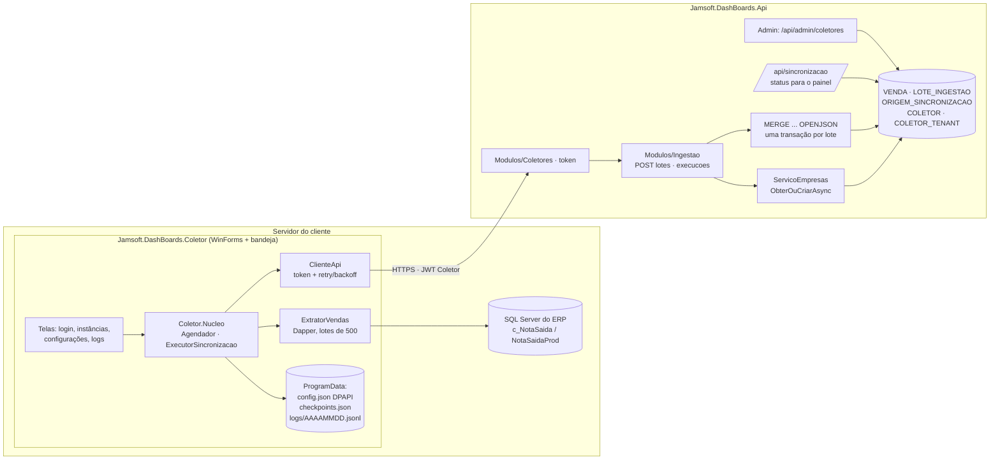
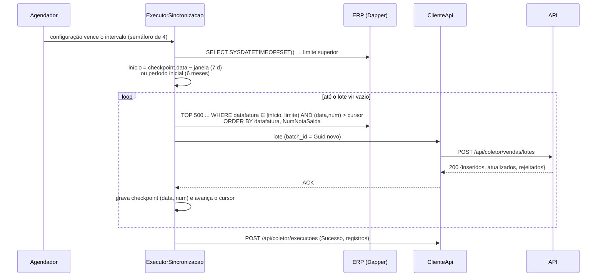

# Sincronização de Vendas — Coletor e Ingestão — Design

**Spec**: `.specs/features/sincronizacao-vendas/spec.md`
**Decisões aplicadas**: AD-001 a AD-012; novas AD-013 a AD-016 (`.specs/STATE.md`)
**Depende de**: `plataforma-tenancy-acesso` (verificada, PASS)
**Status**: Draft

---

## Architecture Overview

Duas pontas e um contrato:

- **Coletor** (AD-013): três projetos. `Jamsoft.DashBoards.Contratos` guarda os DTOs compartilhados com a API. `Jamsoft.DashBoards.Coletor.Nucleo` concentra agendamento, extração via Dapper, cliente HTTP, checkpoint e logs, e é testável sem UI. `Jamsoft.DashBoards.Coletor` é a casca Windows Forms: telas e ícone na bandeja.
- **API**: dois módulos novos. `Modulos/Coletores` cuida das credenciais e dos tenants autorizados. `Modulos/Ingestao` recebe os lotes, grava o estado das execuções e expõe o status ao painel. O Coletor recebe um JWT próprio (AD-015). A ingestão grava cada lote com um único `MERGE` alimentado por `OPENJSON` e guarda o resultado do lote para responder igual quando o mesmo lote voltar (AD-014).



### Fluxo de uma execução incremental



A falha de comunicação passa pelo retry com backoff (2, 4, 8, 16, 32 s). Esgotadas as tentativas, a execução termina como "Falha" e o checkpoint fica no último lote confirmado (SYNC-04). No ciclo seguinte, o lote é montado de novo a partir do checkpoint. O `batch_id` muda, mas o upsert por chave de negócio garante que nada se duplica.

---

## Code Reuse Analysis

### Existing Components to Leverage

| Component | Location | How to Use |
| --------- | -------- | ---------- |
| `TokenService` + `JwtOptions` | `src/Jamsoft.DashBoards.Api/Seguranca/TokenService.cs` | Ganha um `EmitirColetor(coletor, tenants)` com a mesma chave, os mesmos parâmetros de validação e 15 min de validade |
| Policy `Coletor` + `PerfilRequirement` | `Seguranca/Policies.cs` | Já existe. As rotas `/api/coletor/**` passam a usá-la. O `RevalidarAcessoAsync` hoje ignora o Coletor; passa a chamar o `StatusColetorCache` |
| `StatusAcessoCache` (padrão TTL 60 s + invalidação) | `Seguranca/StatusAcessoCache.cs` | Mesmo padrão para o `StatusColetorCache`: credencial ativa e versão da credencial |
| `ITenantAtual` / `TenantAtual` | `Seguranca/TenantAtual.cs` | Implementa o `TenantsAutorizadosColetor` já previsto (claim `tenants`); a ingestão abre um escopo com `TenantFixo` no tenant do lote |
| `ServicoEmpresas.ObterOuCriarAsync` | `Modulos/Empresas/Empresas.cs` | EMP-04: cria a empresa na primeira venda. Contrato documentado: o contexto precisa estar no tenant do lote |
| `ProblemasApi` / `ProblemaApiException` | `Infraestrutura/Erros/ProblemasApi.cs` | Todos os erros novos (AD-011) |
| `ServicoAuditoria` + `OperacaoAuditada` | `Modulos/Auditoria/Auditoria.cs` | AUD-01, parte do Coletor: `COLETOR_CRIADO`, `COLETOR_REVOGADO`, `COLETOR_SECRET_ROTACIONADO`, `COLETOR_TENANTS_ALTERADOS` |
| Geração/hash de segredo + `FixedTimeEquals` | `RefreshTokens.cs` (padrão do `ApiKey.cs` do Sge.Mcp) | `client_secret`: 32 bytes aleatórios, só o SHA-256 vai para o banco |
| `ResultadoPaginado<T>`, `versao` em Base64, 409 por índice único | `Modulos/Tenants/TenantsEndpoints.cs` | Listagem e edição de coletores |
| `PlanoExclusao` (descoberta automática por `IPertenceAoTenant`) | `Modulos/Exclusao/PlanoExclusao.cs` | As tabelas novas do tenant entram sozinhas na exclusão; o teste de arquitetura garante isso |
| Suíte de isolamento T39 + regras T40 | `tests/.../Integracao/Dados/IsolamentoTenantsTestes.cs`, `Arquitetura/` | Rotas novas tenant-scoped precisam de caso cadastrado. A allowlist de bypass recebe `Modulos.Coletores` |
| Query de vendas e índices sugeridos | `Jamsoft.Sge.Mcp/Dados/VendasRepositorio.cs`, `sql/002_banco_cliente_indices_e_usuario.sql` | Mesma consulta, filtro `datafatura >= @Inicio AND < @Fim`, usuário só de leitura no ERP e índice em `NotaSaidaProd(numnotasaida)` |
| `BancoDeTestes`, `ApiFactory`, `Acesso`, `Dados` | `tests/Jamsoft.DashBoards.Api.Testes/Infraestrutura/` | Testes de integração da API e testes ponta a ponta Coletor → API |

### Integration Points

| System | Integration Method |
| ------ | ------------------ |
| Banco do ERP (SQL Server do cliente) | Dapper + `Microsoft.Data.SqlClient` com um usuário só de leitura, `READ COMMITTED`, `CommandTimeout = 120 s` |
| API da plataforma | HTTPS + JSON com os DTOs de `Jamsoft.DashBoards.Contratos`. Erros em ProblemDetails com `codigo` |
| Feature `painel-vendas` | Lê `VENDA` (índice `TENANT_ID, DATA_HORA`) e `GET /api/sincronizacao/resumo` (STS-02) |
| Exclusão de tenant | As tabelas novas implementam `IPertenceAoTenant` e entram no `PlanoExclusao` |

---

## Estrutura da solução (acréscimos)

```
src/
  Jamsoft.DashBoards.Contratos/             net10.0 — DTOs da API do Coletor (sem dependências)
    Coletor/TokenColetorRequisicao.cs, TokenColetorResposta.cs, TenantAutorizado.cs
    Ingestao/LoteVendas.cs, VendaContrato.cs, ResultadoLote.cs, RelatorioExecucao.cs
  Jamsoft.DashBoards.Api/
    Modulos/Coletores/   Coletor.cs, ColetorTenant.cs, ColetoresEndpoints.cs (admin), TokenColetorEndpoint.cs,
                         SegredoColetor.cs, StatusColetorCache.cs
    Modulos/Ingestao/    Venda.cs, LoteIngestao.cs, OrigemSincronizacao.cs, LotesEndpoint.cs,
                         ValidacaoVenda.cs, GravadorVendas.cs (MERGE/OPENJSON), ExecucoesEndpoint.cs,
                         SincronizacaoEndpoints.cs (status para o painel)
  Jamsoft.DashBoards.Coletor.Nucleo/        net10.0-windows (DPAPI)
    Configuracao/   ArmazenamentoConfiguracao.cs, ConfiguracaoSincronizacao.cs, InstanciaConexao.cs,
                    ProtetorSegredos.cs (DPAPI LocalMachine)
    Sincronizacao/  Agendador.cs, ExecutorSincronizacao.cs, Checkpoints.cs, Janela.cs
    Erp/            ExtratorVendas.cs (Dapper), ConexoesErp.cs (testar conexão / listar bancos)
    Api/            ClienteApi.cs (token, retry/backoff, 401 → renova 1x)
    Logs/           LogExecucoes.cs (JSON lines diário, retenção 30 d), LeitorLogs.cs
  Jamsoft.DashBoards.Coletor/               net10.0-windows, WinForms, Generic Host
    Program.cs, FormPrincipal.cs, FormLogin.cs, FormInstancia.cs, FormConfiguracao.cs, FormLogs.cs, Bandeja.cs
tests/
  Jamsoft.DashBoards.Api.Testes/            + Integracao/Coletores, Integracao/Ingestao
  Jamsoft.DashBoards.Coletor.Testes/        xUnit — unidade do Nucleo + integração com ERP falso
                                            (banco de testes com c_NotaSaida/NotaSaidaProd) + ponta a ponta
                                            Coletor.Nucleo → API (WebApplicationFactory)
```

---

## Components — API

### Coletores (módulo `Coletores`)

- **Purpose**: credenciais por instalação e lista de tenants autorizados (AD-005, COL-*).
- **Interfaces (HTTP, policy `SuperAdmin`)**:
  - `POST /api/admin/coletores` `{ nome, tenants: [idPublico] }` → 201 `{ idPublico, clientId, clientSecret }`. O secret aparece **só** nesta resposta (COL-01).
  - `GET /api/admin/coletores`: lista paginada com nome, `clientId`, situação, tenants autorizados (id e nome) e última atividade.
  - `PUT /api/admin/coletores/{idPublico}/tenants` `{ tenants, versao }` (COL-07).
  - `POST /api/admin/coletores/{idPublico}/rotacionar` → `{ clientSecret }` (COL-06).
  - `POST /api/admin/coletores/{idPublico}/revogar` (COL-05).
- **Interfaces (HTTP, anônima com rate limit)**: `POST /api/coletor/token` `{ clientId, clientSecret }` → `{ accessToken, expiraEm, tenants: [{ idPublico, nome }] }` (COL-03). Credencial inválida ou revogada → 401 `CREDENCIAL_INVALIDA` (COL-04). Rate limit de 20 por minuto por IP.
- **Regras**:
  - `client_id` é um GUID. O `client_secret` tem 32 bytes aleatórios em Base64Url (43 caracteres) e só o SHA-256 é gravado (COL-02). A comparação usa `FixedTimeEquals`.
  - Só tenants **ativos** podem ser autorizados. A lista precisa ter ao menos 1 tenant (COL-01).
  - Toda rotação, revogação ou mudança de tenants incrementa `VERSAO_CREDENCIAL`. O token leva a claim `cred_ver`. O `StatusColetorCache` (TTL de 60 s) recusa token cuja `cred_ver` seja diferente da atual ou cuja credencial esteja revogada → 401. Isso derruba tokens antigos em até 60 s, abaixo dos 15 min do COL-05.
  - JWT do Coletor: `sub` = `ID_PUBLICO` do coletor, `perfil = Coletor`, `tenants` = lista de ID públicos, `cred_ver`, 15 min. Esse token só atende à policy `Coletor` (COL-09, já garantido).
  - Auditoria: criação, rotação, revogação e mudança de tenants.
- **Requisitos**: COL-01..COL-09, parte Coletor do AUD-01.

### Ingestão de lotes (módulo `Ingestao`)

- **Interface**: `POST /api/coletor/vendas/lotes` (policy `Coletor`, limite de corpo de 2 MB)

```jsonc
{
  "batchId": "guid",
  "tenant": "guid (ID_PUBLICO)",
  "configuracaoId": "guid (gerado pelo Coletor, estável por configuração)",
  "rotina": "Vendas",
  "bancoOrigem": "SRV01/SGE_LOJA",        // só exibição; sem credenciais
  "vendas": [ { "vendaId": 1, "tipoDfe": "NFC-e", "dataHora": "2026-10-20T14:03:00-03:00",
                "valor": 123.45, "codCliente": 10, "nomeCliente": "...", "vendedorCodigo": 3,
                "vendedorNome": "...", "situacao": "Finalizada", "nomeEmpresa": "...",
                "codEmpresa": 1, "qtdItens": 4 } ]
}
```

  Resposta 200: `{ batchId, inseridos, atualizados, rejeitados: [{ vendaId, codEmpresa, motivo }] }`.
- **Pipeline**, numa transação (ING-07):
  1. Corpo acima de 2 MB → 413, pelo limite do Kestrel na rota. Mais de 500 vendas → 413 `LOTE_GRANDE_DEMAIS` (ING-08).
  2. Tenant fora da claim `tenants` → 403 `TENANT_NAO_AUTORIZADO` (ING-02). Tenant inativo → 403 `TENANT_INATIVO` (ING-03), via `StatusAcessoCache`.
  3. Abre um escopo de DI com `TenantFixo(tenant)`. Daqui em diante o filtro global e o interceptor protegem as gravações sem nenhum bypass.
  4. Idempotência: lê `LOTE_INGESTAO (TENANT_ID, BATCH_ID)`. Se existir, devolve a `RESPOSTA` gravada (ING-05).
  5. `ValidacaoVenda` separa as vendas inválidas e devolve cada uma com `vendaId` e motivo (ING-06). Strings longas demais são truncadas, não rejeitadas (edge case).
  6. Resolve ou cria a `ORIGEM_SINCRONIZACAO` (`TENANT_ID`, `CONFIGURACAO_ID`, `ROTINA`).
  7. Para cada `codEmpresa` distinto, chama `ServicoEmpresas.ObterOuCriarAsync` (EMP-04). Se a empresa já pertence a outra origem (`EMPRESA.ORIGEM_ID` diferente e não nulo), devolve 409 `EMPRESA_VINCULADA_A_OUTRA_ORIGEM` e não grava nada do lote (ING-10). Empresa sem origem, criada à mão ou nova, passa a pertencer a esta origem.
  8. `GravadorVendas.GravarAsync` executa o MERGE (abaixo) e devolve as contagens.
  9. Insere a linha em `LOTE_INGESTAO` com a resposta serializada. Se dois envios do mesmo lote correrem juntos, o segundo esbarra no índice único (2601), relê a resposta e a devolve.
- **MERGE** (AD-014). O lote vai como um único parâmetro `nvarchar(max)` em JSON:

```sql
MERGE dbo.VENDA WITH (HOLDLOCK) AS v
USING (SELECT @TenantId AS TENANT_ID, j.* FROM OPENJSON(@Vendas) WITH (
         COD_EMPRESA int, VENDA_ID int, EMPRESA_ID int, TIPO_DFE varchar(6), DATA_HORA datetimeoffset(0),
         VALOR decimal(19,4), COD_CLIENTE int, NOME_CLIENTE nvarchar(120), VENDEDOR_CODIGO int,
         VENDEDOR_NOME nvarchar(80), SITUACAO nvarchar(12), QTD_ITENS int) j) AS s
   ON v.TENANT_ID = s.TENANT_ID AND v.COD_EMPRESA = s.COD_EMPRESA AND v.VENDA_ID = s.VENDA_ID
WHEN MATCHED THEN UPDATE SET ... , ALTERADO_EM = SYSUTCDATETIME(), ORIGEM_ID = @OrigemId
WHEN NOT MATCHED THEN INSERT (...) VALUES (...)
OUTPUT $action;
```

  `HOLDLOCK` evita corrida entre dois lotes com as mesmas chaves. A contagem de `$action` dá inseridos e atualizados (ING-04). O SQL é fixo e parametrizado (`ExecuteSqlRaw` com `SqlParameter`); o tenant vem do escopo, nunca do JSON.
- **`POST /api/coletor/execucoes`** (policy `Coletor`) `{ tenant, configuracaoId, rotina, bancoOrigem, inicio, fim, situacao, registrosEnviados, mensagem }`: atualiza a `ORIGEM_SINCRONIZACAO` com a última execução e, se o resultado for Sucesso, `ULTIMO_SUCESSO_EM` (ING-09).
- **`GET /api/coletor/tenants`** (policy `Coletor`): tenants autorizados com nome, para a tela de configuração (CFG-02/05).
- **Requisitos**: ING-01..ING-10, EMP-04 (ponta a ponta).

### Status para o painel (`SincronizacaoEndpoints`)

- `GET /api/sincronizacao` (policy `AdminTenant`, `.ValidarContextoTenant()`): lista as origens do tenant com rotina, banco de origem, `ultimoSucessoEm`, `ultimaSituacao`, `ultimaMensagem` e datas (STS-01).
- `GET /api/sincronizacao/resumo` (policy `LeituraTenant`, `.ValidarContextoTenant()`): `{ ultimoSucessoEm }`, o menor entre as origens ativas do tenant; `null` quando o tenant nunca sincronizou (STS-02).
- STS-03 fica no frontend: alerta quando `agora − ultimoSucessoEm` passa de 24 h, mostrado só para Admin e SuperAdmin. Essas rotas entram na suíte de isolamento (T39).

---

## Components — Coletor

### ArmazenamentoConfiguracao + ProtetorSegredos

- **Purpose**: estado local do Coletor (CFG-*), que nunca sai do servidor do cliente.
- **Location**: `%ProgramData%\Jamsoft\DashBoards.Coletor\config.json`, com ACL restrita a Administradores e SYSTEM.
- **Conteúdo**:
  - URL da API, `clientId` e `clientSecret` cifrado.
  - Instâncias: servidor, porta, tipo de autenticação, usuário e senha cifrada.
  - Configurações: `id` (GUID estável), tenant, instância, banco, rotina, intervalo (5 min a 24 h, padrão 15 min), período inicial, janela de reprocessamento (0 a 90 dias, padrão 7), situação Ativa/Pausada/Inativa e "iniciar com o Windows".
- **Segredos**: DPAPI (`ProtectedData`, escopo `LocalMachine` + entropia fixa do produto). Nunca vão para log nem para mensagem de erro (CFG-08). A connection string é montada na memória a cada uso e nunca é gravada inteira.
- **Gravação atômica**: escreve num arquivo temporário e troca pelo definitivo com `File.Replace`.

### Checkpoints

- `checkpoints.json`: por `(configuracaoId, rotina)` guarda `{ dataFatura, numNotaSaida, ultimoSucessoEm, situacao }` (SYNC-09).
- Atualizado **só** depois do ACK de cada lote (AD-007, SYNC-03), com gravação atômica.
- Reiniciar (CTL-04) apaga só a entrada daquela configuração.

### ExtratorVendas (Dapper)

- **Interfaces**:
  - `Task<DateTimeOffset> AgoraDoServidorAsync(ct)`: `SELECT SYSDATETIMEOFFSET()`, o limite superior da execução (edge case do relógio).
  - `Task<IReadOnlyList<VendaErp>> LerLoteAsync(inicio, fimExclusivo, cursor?, tamanho = 500, ct)`.
- **SQL**: a query do §11 com as regras confirmadas pelo usuário em 2026-10-25, mais a `datafatura` para o checkpoint e paginação por keyset:

```sql
SELECT TOP (@Tamanho)
    ns.NumNotaSaida                                    AS venda_id,
    CASE WHEN ns.modelo = 65 THEN 'NFC-e' ELSE 'NF-e' END AS tipo_dfe,
    ns.DataHoraFechamento                              AS data_hora,      -- data e hora (painel)
    ns.datafatura                                      AS data_fatura,    -- só data (filtro/checkpoint)
    ns.totnota                                         AS valor,
    ns.codcliente                                      AS cod_cliente,
    ns.FANTASIA                                        AS nome_cliente,
    ns.codvendedor                                     AS vendedor_codigo,
    ns.nomevend                                        AS vendedor_nome,
    CASE ns.situacaonota
        WHEN 5  THEN 'Finalizada'
        WHEN 6  THEN 'Finalizada'
        WHEN 9  THEN 'Cancelada'
        WHEN 11 THEN 'Inutilizada'
        WHEN 12 THEN 'Contingência'
    END                                                AS situacao,
    ns.Empresa                                         AS nome_empresa,
    ns.codEmpresa                                      AS cod_empresa,
    (SELECT COUNT(*) FROM NotaSaidaProd
      WHERE NotaSaidaProd.numnotasaida = ns.numnotasaida) AS qtd_itens
FROM c_NotaSaida AS ns
WHERE ns.situacaonota IN (5, 6, 9, 11, 12)             -- somente estes status
  AND ns.TotalCondNeutra = 0                          -- somente vendas sem valor neutro
  AND ns.datafatura >= @Inicio AND ns.datafatura < @Fim
  AND (ns.datafatura > @CursorData
       OR (ns.datafatura = @CursorData AND ns.NumNotaSaida > @CursorNum))
ORDER BY ns.datafatura, ns.NumNotaSaida;
```

  Na primeira página do ciclo, o cursor começa em (`@Inicio`, 0). Só parâmetros, nunca concatenação (SYNC-07). `CommandTimeout = 120` (SYNC-08). `READ COMMITTED`.
- **Origem confirmada (2026-10-25)**: `c_NotaSaida` é uma **view** sobre a tabela `NotaSaida`, e `NumNotaSaida` é a identity dessa tabela, única em todo o banco do ERP. O que isso implica:
  - **Índice e permissões**: o índice que sustenta o keyset vai na **tabela base**, `NotaSaida (datafatura, NumNotaSaida) INCLUDE (situacaonota, TotalCondNeutra, modelo, DataHoraFechamento, totnota, codcliente, codvendedor, codEmpresa)`, mais `NotaSaidaProd (numnotasaida)` para o `QtdItens`. O usuário só de leitura recebe `SELECT` na view `c_NotaSaida` e em `NotaSaidaProd`, sem acesso à tabela base. Tudo isso vai num script a ser executado no ERP, `sql/coletor/001_erp_usuario_leitura_e_indices.sql`, derivado do `002_banco_cliente_indices_e_usuario.sql` do Sge.Mcp. O técnico confere o plano de execução antes de criar os índices.
  - **Ordem de inserção**: como `NumNotaSaida` é identity, uma nota nova nunca recebe número menor que outra já gravada. Mesmo assim, a janela de reprocessamento continua necessária: cancelamentos e alterações em notas já sincronizadas mudam a situação sem criar nota nova, e uma nota pode ter `datafatura` retroativa.
- **Mapeamento**: aplica o contrato (truncamentos e domínio de `situacao`/`tipoDfe`) antes de enviar. `DataHoraFechamento` vira `dataHora` com o offset de America/Sao_Paulo. Se vier nula, usa `datafatura` às 00:00 e grava aviso no log (premissa a confirmar).

### ClienteApi

- `HttpClient` com `Microsoft.Extensions.Http.Resilience`: 5 tentativas com backoff exponencial (2, 4, 8, 16, 32 s) em falhas transitórias (5xx, timeout, rede). Não repete 4xx.
- Token cacheado até 1 min antes de expirar. Um 401 renova uma vez e reenvia o lote atual (edge case do token expirado).
- 403 `TENANT_NAO_AUTORIZADO` ou `TENANT_INATIVO` → a configuração vai para "Não autorizada", não executa mais e grava log (edge case). 401 depois da renovação → credencial revogada: todas as configurações ficam paradas até um novo login.

### ExecutorSincronizacao

- Para uma configuração: define a janela (carga inicial = período inicial, padrão hoje − 6 meses; incremental = `checkpoint.dataFatura − janela`), lê os lotes, envia, grava o checkpoint por ACK e reporta a execução (SYNC-01..06, SYNC-05).
- Verifica o pedido de pausa ou reinício **entre lotes** (CTL-01, CTL-06).
- Classifica o erro como Conexão, Consulta, Comunicação ou Processamento para o log (LOG-03).

### Agendador

- Um loop por configuração ativa. A próxima execução começa no `fim da anterior + intervalo` (SCH-01). Cada configuração tem um único loop, então nunca executa duas vezes ao mesmo tempo (SCH-02).
- Um `SemaphoreSlim(4)` global limita a 4 execuções simultâneas (SCH-03). Uma falha só afeta a própria configuração (SCH-04).
- Ao iniciar, retoma a partir dos checkpoints (SCH-05).
- Comandos vindos da UI (pausar, retomar, reiniciar) chegam por `Channel<ComandoConfiguracao>`.

### LogExecucoes

- Arquivo `logs\coletor-AAAAMMDD.jsonl`, com uma linha JSON por evento (LOG-01). O evento `execucao_fim` traz início, fim, duração, lidos, enviados, rejeitados e resultado (LOG-02). Retenção de 30 dias, limpa na inicialização e uma vez por dia (LOG-06).
- Sanitização na escrita: os campos são tipados e nenhum aceita connection string ou segredo; a mensagem de exceção passa por um filtro de `Password=`/`Pwd=` (LOG-04).
- `LeitorLogs` filtra por data, tenant, banco, rotina e resultado para a tela (LOG-05).

### Coletor (WinForms)

- Generic Host (`Microsoft.Extensions.Hosting`) com DI para os componentes do Nucleo. O Agendador roda como `BackgroundService` enquanto o app estiver aberto, e fechar a janela minimiza para a bandeja.
- **Telas**:
  - `FormLogin`: URL, client id e secret (CFG-02).
  - `FormPrincipal`: grade com tenant, banco, situação, intervalo, último sucesso e último resultado, e os botões pausar/retomar/reiniciar/editar/excluir (CFG-10, CTL-*).
  - `FormInstancia`: testar conexão e listar bancos (CFG-03/04).
  - `FormConfiguracao` (CFG-05..07).
  - `FormLogs` (LOG-05).
  - Enquanto não houver login, só `FormLogin` e `FormLogs` ficam acessíveis (CFG-01).
- "Iniciar com o Windows" é opcional: grava na chave `HKCU\...\Run` do usuário, só quando o técnico marca a opção.

---

## Data Models (API)

Mesmas convenções da feature anterior: UPPER_SNAKE, `ID_PUBLICO`, `ROWVERSION` nas tabelas editáveis e FKs `NO ACTION`.

```sql
COLETOR (
  ID INT IDENTITY PK, ID_PUBLICO UNIQUEIDENTIFIER UQ, NOME NVARCHAR(80) NOT NULL,
  CLIENT_ID UNIQUEIDENTIFIER NOT NULL UQ, SECRET_HASH BINARY(32) NOT NULL,
  ATIVO BIT NOT NULL DEFAULT 1, VERSAO_CREDENCIAL INT NOT NULL DEFAULT 1,
  CRIADO_EM DATETIME2(0), REVOGADO_EM DATETIME2(0) NULL, ULTIMO_TOKEN_EM DATETIME2(0) NULL, VERSAO ROWVERSION )

COLETOR_TENANT (                                 -- IPertenceAoTenant
  COLETOR_ID INT FK→COLETOR, TENANT_ID INT FK→TENANT, PK (TENANT_ID, COLETOR_ID) )

ORIGEM_SINCRONIZACAO (                           -- IPertenceAoTenant
  ID INT IDENTITY PK, ID_PUBLICO UNIQUEIDENTIFIER UQ, TENANT_ID INT FK→TENANT, COLETOR_ID INT FK→COLETOR,
  CONFIGURACAO_ID UNIQUEIDENTIFIER NOT NULL, ROTINA VARCHAR(30) NOT NULL, BANCO_ORIGEM NVARCHAR(256) NULL,
  ULTIMA_EXECUCAO_INICIO DATETIME2(0) NULL, ULTIMA_EXECUCAO_FIM DATETIME2(0) NULL,
  ULTIMA_SITUACAO VARCHAR(20) NULL, ULTIMA_MENSAGEM NVARCHAR(500) NULL, REGISTROS_ULTIMA INT NULL,
  ULTIMO_SUCESSO_EM DATETIME2(0) NULL,
  UQ (TENANT_ID, CONFIGURACAO_ID, ROTINA) )

EMPRESA  + ORIGEM_ID INT NULL FK→ORIGEM_SINCRONIZACAO   -- dona da empresa (ING-10)

VENDA (                                          -- IPertenceAoTenant
  ID BIGINT IDENTITY PK, TENANT_ID INT FK→TENANT, EMPRESA_ID INT FK→EMPRESA, COD_EMPRESA INT NOT NULL,
  VENDA_ID INT NOT NULL, TIPO_DFE VARCHAR(6) NOT NULL, DATA_HORA DATETIMEOFFSET(0) NOT NULL,
  VALOR DECIMAL(19,4) NOT NULL, COD_CLIENTE INT NULL, NOME_CLIENTE NVARCHAR(120) NULL,
  VENDEDOR_CODIGO INT NULL, VENDEDOR_NOME NVARCHAR(80) NULL, SITUACAO NVARCHAR(12) NOT NULL,
  QTD_ITENS INT NOT NULL, ORIGEM_ID INT FK→ORIGEM_SINCRONIZACAO,
  RECEBIDO_EM DATETIME2(0) DEFAULT SYSUTCDATETIME(), ALTERADO_EM DATETIME2(0) NULL,
  UQ (TENANT_ID, COD_EMPRESA, VENDA_ID),
  IX (TENANT_ID, DATA_HORA) INCLUDE (EMPRESA_ID, VALOR, SITUACAO, TIPO_DFE, QTD_ITENS,
                                     VENDEDOR_CODIGO, COD_CLIENTE),            -- painel-vendas
  CK SITUACAO IN (N'Finalizada',N'Cancelada',N'Inutilizada',N'Contingência'), CK TIPO_DFE IN ('NF-e','NFC-e'),
  CK VALOR >= 0, CK QTD_ITENS >= 0 )

LOTE_INGESTAO (                                  -- IPertenceAoTenant
  ID BIGINT IDENTITY PK, TENANT_ID INT FK→TENANT, BATCH_ID UNIQUEIDENTIFIER NOT NULL,
  ORIGEM_ID INT FK→ORIGEM_SINCRONIZACAO, RECEBIDO_EM DATETIME2(0),
  INSERIDOS INT, ATUALIZADOS INT, REJEITADOS INT, RESPOSTA NVARCHAR(MAX) NOT NULL,
  UQ (TENANT_ID, BATCH_ID), IX (RECEBIDO_EM) )
```

**Relationships**: COLETOR N–N TENANT via COLETOR_TENANT. ORIGEM_SINCRONIZACAO pertence a um TENANT e a um COLETOR. VENDA referencia EMPRESA e ORIGEM. O `PlanoExclusao` ordena VENDA → LOTE_INGESTAO → EMPRESA → ORIGEM_SINCRONIZACAO → COLETOR_TENANT → … → TENANT. A tabela `COLETOR` fica fora do plano, porque não pertence a um tenant.

### Contrato (DTOs em `Jamsoft.DashBoards.Contratos`)

```csharp
public sealed record LoteVendas(Guid BatchId, Guid Tenant, Guid ConfiguracaoId, string Rotina,
    string? BancoOrigem, IReadOnlyList<VendaContrato> Vendas);
public sealed record VendaContrato(int VendaId, string TipoDfe, DateTimeOffset DataHora, decimal Valor,
    int? CodCliente, string? NomeCliente, int? VendedorCodigo, string? VendedorNome, string Situacao,
    string NomeEmpresa, int CodEmpresa, int QtdItens);
public sealed record ResultadoLote(Guid BatchId, int Inseridos, int Atualizados, IReadOnlyList<VendaRejeitada> Rejeitados);
public sealed record VendaRejeitada(int VendaId, int CodEmpresa, string Motivo);
public sealed record RelatorioExecucao(Guid Tenant, Guid ConfiguracaoId, string Rotina, string? BancoOrigem,
    DateTimeOffset Inicio, DateTimeOffset Fim, string Situacao, int RegistrosEnviados, string? Mensagem);
public static class Limites { public const int VendasPorLote = 500; public const int BytesPorLote = 2 * 1024 * 1024; }
```

---

## Error Handling Strategy

| Error Scenario | Handling | User Impact |
| -------------- | -------- | ----------- |
| `clientId`/secret inválido ou credencial revogada | 401 `CREDENCIAL_INVALIDA` | Coletor: tela de login com "Credencial inválida ou revogada" |
| Token de credencial rotacionada ou revogada (versão antiga) | 401 `NAO_AUTENTICADO` em até 60 s | Coletor renova; se falhar, para tudo e pede login |
| Tenant fora da credencial | 403 `TENANT_NAO_AUTORIZADO` | Configuração vira "Não autorizada" |
| Tenant inativo | 403 `TENANT_INATIVO` | Configuração vira "Não autorizada" (tenant suspenso) |
| Lote com mais de 500 vendas ou corpo acima de 2 MB | 413 `LOTE_GRANDE_DEMAIS` | Erro de Processamento no log; não acontece com o Coletor oficial |
| Venda fora do contrato | 200, venda em `rejeitados` com motivo | Contagem de rejeitados no log |
| Empresa de outra origem | 409 `EMPRESA_VINCULADA_A_OUTRA_ORIGEM` | Execução "Falha" com a mensagem; o técnico corrige o vínculo |
| Lote repetido | 200 com a resposta original | Transparente |
| ERP inacessível ou consulta acima de 120 s | O Coletor cancela, classifica (Conexão/Consulta) e mantém o checkpoint | Execução "Falha"; nova tentativa no próximo ciclo |
| API fora do ar | Retry 2/4/8/16/32 s, depois "Falha" (Comunicação) | Nova tentativa no próximo ciclo; nada se perde |
| Admin cria coletor sem tenant ou com tenant inativo | 400 `VALIDACAO` | Mensagem no campo |
| Não SuperAdmin em `/api/admin/coletores` | 403 `ACESSO_NEGADO` | — |

---

## Risks & Concerns

| Concern | Location (file:line) | Impact | Mitigation |
| ------- | -------------------- | ------ | ---------- |
| A extração do §11 está definida (situações, valor neutro, `DataHoraFechamento`, `QtdItens`, view e identity confirmados em 2026-10-25). Ainda não foi executada no ERP real, e não se sabe se `DataHoraFechamento` pode vir nula | `Coletor.Nucleo/Erp/ExtratorVendas.cs` (a criar) | Plano de execução ruim no ERP ou vendas sem hora | A query fica isolada numa constante única e é executada no ERP real antes do piloto, com conferência do plano de execução. `DataHoraFechamento` nula cai em `datafatura` 00:00 com aviso no log. Os testes do extrator rodam contra um ERP falso que reproduz a estrutura: tabela `NotaSaida` com identity, view `c_NotaSaida` e `NotaSaidaProd` |
| `EMPRESA.ORIGEM_ID` cria um ciclo lógico entre empresa e origem | `Modulos/Empresas/Empresa.cs:9` | `PlanoExclusao` sem ordem válida | O ciclo é só lógico: as FKs são EMPRESA→ORIGEM e ORIGEM→TENANT/COLETOR, sem FK de volta. O teste de ordem do plano (T35) cobre o caso |
| `COLETOR_TENANT` é do tenant, mas a listagem do admin atravessa tenants | `Modulos/Coletores` | Bypass do filtro fora da allowlist | Acrescentar `Modulos.Coletores` à allowlist de `RegrasArquiteturaTestes` (mudança explícita e revisada); a leitura no admin usa `IgnoreQueryFilters([FiltroTenant])` |
| DPAPI `LocalMachine`: qualquer processo local com privilégio decifra os segredos | `ProtetorSegredos.cs` | Exposição no servidor do cliente | Aceito: o servidor do ERP já guarda credenciais equivalentes. Mitigações: ACL na pasta de dados, usuário do ERP só de leitura (script do Sge.Mcp) e credencial do Coletor revogável |
| `LOTE_INGESTAO` cresce sem limite | `Modulos/Ingestao/LoteIngestao.cs` | Tabela grande | Retenção de 30 dias por uma limpeza diária num `BackgroundService` simples; o reenvio de lote só acontece em minutos ou horas |
| SQL Server local com pouca memória deixa a suíte de testes instável | Ambiente de dev | Gates oscilantes | `Connect Timeout=60` e comandos administrativos com 120 s (já no fixture); repetir uma vez só em timeout de infraestrutura |
| MERGE tem bugs históricos com índices filtrados/views indexadas | `GravadorVendas.cs` | Resultado incorreto | VENDA não tem índice filtrado nem view indexada; `HOLDLOCK` + chave única; testes de concorrência com dois lotes sobrepostos |
| WinForms é difícil de testar automaticamente | `Jamsoft.DashBoards.Coletor` | Regressões de UI | A casca não tem lógica: tudo o que é testável fica no Nucleo. A UI tem um roteiro de UAT manual (CFG-01/03/04/10, CTL-*, LOG-05) |

---

## Tech Decisions (only non-obvious ones)

| Decision | Choice | Rationale |
| -------- | ------ | --------- |
| Organização do Coletor | 3 projetos: Contratos + Coletor.Nucleo + Coletor WinForms (AD-013) | Escolha do usuário; lógica testável e contrato único com a API |
| Upsert de vendas | Um `MERGE ... WITH (HOLDLOCK)` com `OPENJSON` por lote, mais `LOTE_INGESTAO` para idempotência (AD-014) | Escolha do usuário; uma ida ao banco por lote, atômico, contagens via `OUTPUT` |
| Auth do Coletor | JWT próprio com `cred_ver`, revalidado a cada 60 s (AD-015) | Reaproveita `TokenService`/policies; revogação rápida sem consultar o banco a cada lote |
| Estado local do Coletor | JSON em `%ProgramData%` + DPAPI LocalMachine, gravação atômica (AD-016) | Sem banco local; segredos fora de texto puro; sobrevive a reinício |
| Paginação no ERP | Keyset (`datafatura`, `NumNotaSaida`) com `TOP 500` | Sem OFFSET; lotes curtos no ERP (§12.1) e cursor determinístico |
| Limite superior da execução | `SYSDATETIMEOFFSET()` do servidor do ERP | Imune ao relógio do servidor do Coletor (edge case) |
| Dona da empresa | `EMPRESA.ORIGEM_ID`, definido na primeira ingestão | Implementa ING-10 sem tabela extra; empresa criada à mão é adotada pela primeira origem |
| Resiliência HTTP | `Microsoft.Extensions.Http.Resilience` (pipeline padrão configurado) | Retry/backoff testável com `TimeProvider`, sem implementação manual |
| Hospedagem do agendador | `BackgroundService` no Generic Host dentro do WinForms | Mesmo modelo de DI e logging da API; Windows Service fica fora de escopo (spec) |
